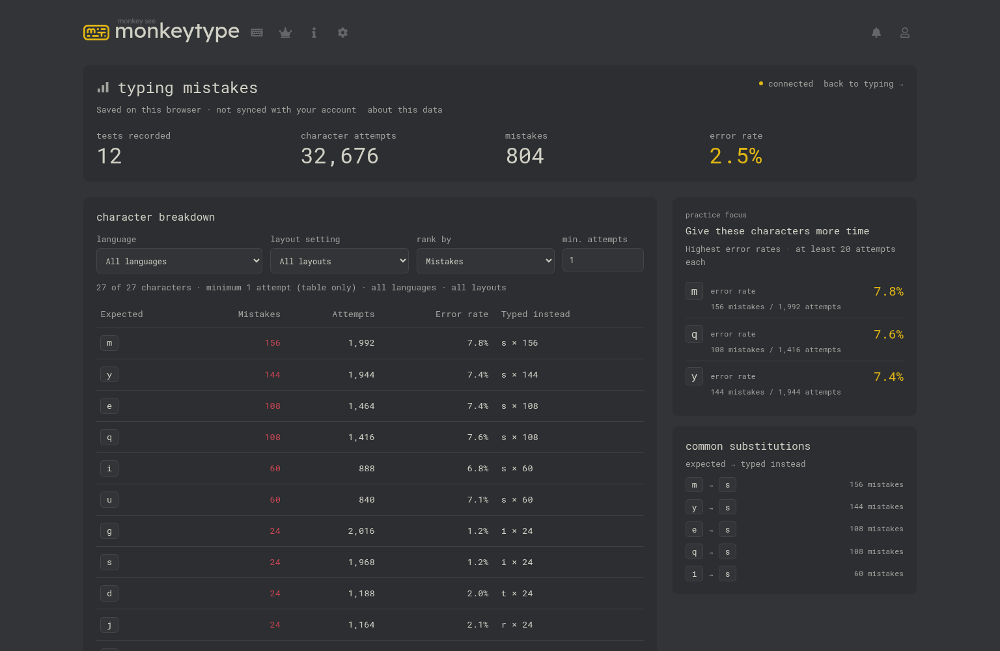

# Monkeytype Typing Mistakes

A free Chrome extension that shows which characters you mistype on Monkeytype and what to practise. Mistakes still count when you correct them with Backspace.

It adds a **Typing mistakes** page inside Monkeytype, using your theme and font. Your stats stay in your browser; no extra account or sync.

**[Download the latest release](https://github.com/vibhor1102/monkeytype-local-analytics/releases/latest)**

*Shown with example data.*

## Install

1. Download **monkeytype-local-analytics-1.4.0.zip** and extract it to a permanent folder.
2. Open `chrome://extensions`, enable **Developer mode**, click **Load unpacked**, and select the folder containing `manifest.json`.
3. Reload Monkeytype and finish a new standard test. Open **Typing mistakes** below **User stats**, or use the extension’s toolbar button without signing in.

Records new tests, not past account results. Tested on desktop Linux Chrome; other platforms haven’t been tested.

[Setup, updates and help](docs/SETUP.md) · [Privacy](PRIVACY.md)

MIT licensed. Independent project, not affiliated with Monkeytype.
